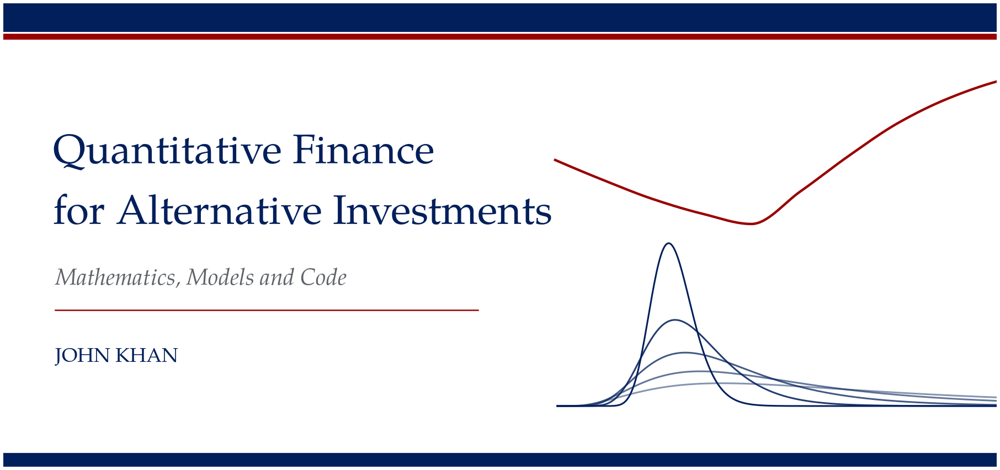

# Quantitative Finance for Alternative Investments

*Mathematics, Models and Code*, by John Khan.

This is a twelve chapter book on the quantitative methods behind alternative investments, written in
LaTeX with the code that produces it. Each chapter states a result, proves it, and checks it with a
number you can reproduce. No number in the text is typed by hand: the Python scripts in `code/` compute
them, write them to a generated macro file, and draw every figure. Independent cross-checks in R and
GNU Octave recompute the main results by different methods, and a test suite ties the three together.

Chapters are released one at a time as each is finished; this copy holds Chapter 1. The repository holds the source only. Run the build below to produce the PDFs.

## Chapters

| # | Chapter | What it covers | Status |
|---|---|---|---|
| 1 | Returns, Rates and the Shape of Risk | Compounding, simple and log returns, returns on collateralised positions, the IRR and the ways it fails, MIRR, time and money weighting, multiples and public market equivalents, the J-curve, lognormal returns, higher moments, correlation and beta, smoothing and unsmoothing, variance ratios and the size and power of normality tests. Case study: daily Government of Canada five year yields. | Released |
| 2 | Fund Structures, Fees and Distribution Waterfalls | Coming soon. | Coming soon |
| 3 | Random Walks and Stochastic Calculus | Coming soon. | Coming soon |
| 4 | Arbitrage, Forwards, Futures and Binomial Trees | Coming soon. | Coming soon |
| 5 | Black-Scholes: Derivation, Greeks and Numerical Checks | Coming soon. | Coming soon |
| 6 | Interest Rates, Credit Risk, Private Credit and Structured Products | Coming soon. | Coming soon |
| 7 | Portfolio Theory, Factor Models, Alpha and Beta | Coming soon. | Coming soon |
| 8 | Risk and Performance Measurement | Coming soon. | Coming soon |
| 9 | Hedge Funds, Managed Futures and Digital Assets | Coming soon. | Coming soon |
| 10 | Real Assets and Commercial Real Estate | Coming soon. | Coming soon |
| 11 | Private Equity and Business Valuation | Coming soon. | Coming soon |
| 12 | Machine Learning in Finance | Coming soon. | Coming soon |

## Repository layout

```
main.tex                 book driver for the released chapters
preamble/quantbook.sty   house style (serif text, blue and red accents)
chapters/chNN.tex        chapter text; chNN-numbers.tex is generated by the code
figures/chNN/*.png       figures, generated by the code at 300 dpi
code/common/             shared plotting style and helpers
code/chNN/               chapter scripts, run_all.py, test_*.py, crosscheck.R, octave/*.m, snippets/
data/                    data snapshot used by the case studies, with its source
scripts/                 cover art and metadata stripping
references.bib           bibliography (biblatex, one reference list per chapter)
```

## Building

You need TeX Live with `latexmk` and `biber`, Python 3.10 or later, R and GNU Octave. `exiftool` is
optional and only used to check metadata.

```
python -m venv .venv
.venv/bin/pip install -r requirements.txt

make code CH=01      # numbers, figures and the R and Octave cross-checks for Chapter 1
make check CH=01     # the same, then the tests and the book PDF
make book            # the book from the current numbers and figures
```

The generated number files (`chapters/chNN-numbers.tex`) and the figures are committed, so `make book`
works straight after cloning. `make code` regenerates both from scratch. Output goes to `build/quant-finance-book.pdf`.

## Running the code

Each chapter folder can be used on its own.

```
.venv/bin/python code/ch01/run_all.py          # every script, numbers to code/ch01/out/numbers.json
.venv/bin/python code/ch01/distributions.py       # one script; random streams are fixed per script
.venv/bin/python -m pytest -q code/ch01        # tests, including agreement with R and Octave
Rscript code/ch01/crosscheck.R
octave-cli --no-gui code/ch01/octave/ch01_check.m
```

Every script uses a fixed seed, so the numbers in the text are reproduced exactly.

## Credits

The open source projects that shaped the writing, the figures and the code are listed with links in
[CREDITS.md](CREDITS.md) and credited by topic at the end of each chapter.

## Licence

See [LICENSE](LICENSE).
